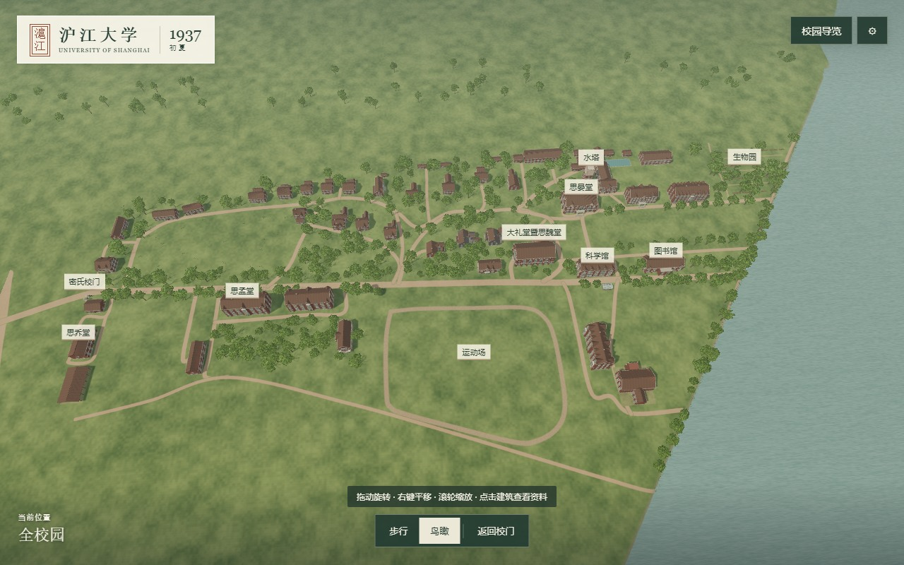

# 沪江大学 · 1937 年校园漫游

以 1937 年平面图和历史照片为依据，在浏览器里复原初夏的沪江大学校园。你可以从密氏校门步行入校、切换鸟瞰或驾驶无人机，也可以在导览中搜索建筑，查看老照片出处和复原依据。



## 如何运行

电脑端可用 Edge 或 Chrome 打开 `hujiang.html`。手机和平板可在支持 WebGL 的浏览器中访问同一页面。这个文件可单独复制，三维场景、纹理和环境录音均可离线使用。打开档案馆与老照片链接时需要联网。

首次进入会显示操作提示，以后可在「浏览设置」中重新查看。底部按钮可直接选择视角，键盘按 V 依次切换「步行 → 鸟瞰 → 无人机 → 步行」。从空中切回步行会回到上次离开的位置，面向原来的方向。

| 模式 | 手机与平板 | 电脑 |
| --- | --- | --- |
| 步行 | 点地面自动绕行，或推左下摇杆。另一只手可同时拖动环顾。 | 单击地面自动绕行，拖动环顾。WASD 可接管移动，Shift 加速。 |
| 鸟瞰 | 单指旋转，双指捏合缩放、同向拖动平移。 | 拖动旋转，右键拖动平移，滚轮缩放。 |
| 无人机 | 摇杆水平飞行，按住右侧箭头升降。 | WASD 水平移动，E／Q 升降，Shift 加速。F 进入无人机，再按 F 回到步行。 |

点左上角小地图可打开水彩校园鸟瞰图，从密氏校门一直看到黄浦江岸。按 M 也可打开或收起地图。圆点显示当前位置，圆环外的短线指示步行或飞行朝向，鸟瞰时圆点标出观察中心。点图上的楼名或建筑可查看资料，点「放大地图」可放大后滚动查看。打开全校图时自动行走暂停，虚线标出剩余路线，关图后继续行走。打开校园导览或设置会结束自动行走。

点建筑后可以边读介绍边漫游，已开始的自动行走也会继续。再点画面中的另一栋楼或鸟瞰中的建筑名称，同一张卡片会显示新介绍，镜头保持在原处。点 × 或切换漫游模式可收起卡片，按 Esc 可关闭最上层的地图、操作提示、建筑介绍、导览或设置。要移动到指定地点，可点卡片上的「到建筑旁步行」或底部的「返回校门」。

把 `hujiang.html` 发给别人，对方下载后用浏览器打开，点「步行」、点地面或按 WASD 即可听到环境音。网页把「浏览设置 → 步行环境音量」记在当前浏览器，调到零即可静音。同一份文件也可放到静态网站供手机访问。

树间的鸟鸣每次漫游会重新组合。近处的一句唱到一半，偶尔有另一只从远处接进来。树下还会听到间歇的叶响。沿运动场北侧主路向江边走，远处的水声要等鸟停口才容易辨认，走近岸线，拍岸才清楚。[江水远近对照](试听/江水调轻/02-蓝线外到红线内.wav) · [树下到运动场试听](试听/树下到运动场.mp3)

## 用了哪些技术

| 技术 | 用途 |
| --- | --- |
| HTML、CSS、原生 JavaScript | 导览搜索、地点介绍卡片、画质设置和键鼠输入。 |
| Three.js r160、WebGL、GLSL | 生成建筑与植被网格，绘制天空、地表和江面，渲染灯光与阴影。 |
| Canvas 2D | 绘制程序纹理和道路遮罩，供三维材质使用。 |
| Web Audio API | 混合鸟鸣、树叶声和江岸水声，随位置和朝向调整音量、音色及左右声道。 |
| Node.js、Playwright | 将分文件源码打包为离线 HTML，并在浏览器里验证漫游、渲染和声音。 |

## 怎么实现的

1. **把老地图换算成场景坐标。** 手工描出 1937 年平面图上的建筑占地、路网与岸线，按四分之一英里跑道的描线长度换算，得到每图像素约 0.483 米。建筑高度、屋面和立面细节结合旧照推定，凭据与推定分别写进地点卡片。[地图坐标与场地数据](src/atlas.js) · [建筑史料记录](src/records.js) · [逐栋核对](建筑逐栋核对.md)
2. **用几何构件搭建筑。** 屋顶、墙体、窗户和门廊由 JavaScript 生成，主要校舍根据各自形制组合，教员住宅与附属设施复用构件。静态网格按材质与空间网格合批，草叶和部分植被使用 `InstancedMesh`，减少绘制调用。[通用构件](src/buildings.js) · [主要校舍](src/halls.js) · [住宅与附属设施](src/residences.js) · [网格合批](src/materials.js)
3. **让太阳、晨光阴影和江面反光方向一致。** 天空着色器与方向光共用一个太阳方向。水面着色器为波纹计算法线，Three.js 根据方向光和波纹法线渲染高光。地面通过道路遮罩混合砂石与草地贴图，砖墙和树皮用法线贴图表现表面起伏。[地表、江面与天空](src/land.js) · [材质贴图](src/surfaces.js) · [光照与视角](src/explore.js)
4. **从同一个场景切换三种视角。** 步行控制器检查场景边界、岸线、建筑和树干，并让视点随地形与台阶升降。无人机把建筑和树冠的高度写入网格，用它约束飞行高度。点击建筑时，从相机发出射线拾取网格，再按建筑编号打开介绍卡片。盾形外框由 CSS 的 `clip-path` 绘制，史料区用 HTML 的 `details` 展开。[交互控制](src/explore.js) · [无人机避障](src/flight.js) · [卡片样式](src/campus.css)
5. **按位置混合步行环境音。** 浏览器解码内嵌的 14 句 FLAC 鸟鸣，按树冠、灌丛和开阔处安排声源。两三只鸟错开起声，按听者的朝向调整左右声道。江水使用同一条连续的浪声，在地图的红蓝线之间平滑衰减。江水和叶响的 Ogg 录音均附有内嵌 MP3 备用。相邻树冠共享同一阵风，离开步行模式或切到后台时声音淡出。[鸟鸣调度](src/birdsong.js) · [江水距离曲线](src/river-audio.js) · [环境音控制](src/ambience.js)

## 开发与验证

开发时可直接打开 `index.html` 调试分文件源码。在仓库根目录执行以下命令，把本地 CSS、脚本及其中的纹理和音频数据内嵌到 `hujiang.html`。构建只用 Node.js 标准库。

```sh
node build.cjs
```

浏览器测试使用 Node.js 24 和 Playwright。在仓库根目录安装测试依赖。

```sh
npm install --no-save --no-package-lock playwright
```

Windows 上测试启动已安装的 Edge。其他平台首次运行前需执行 `npx playwright install chromium`。已有 Playwright 安装也可通过 `PLAYWRIGHT_MODULE` 指定。

```sh
node --test --test-concurrency=1 "tests/*.cjs"
```

测试覆盖步行寻路、触控与小地图、建筑与通行、无人机、光照、环境音和地点卡片。

## 课程与素材来源

- 下载仓库后打开 `course/index.html`，可通过交互示例了解地图坐标换算、水塔建模、无人机避障和单文件打包。[校园源码漫游课程](course/index.html)
- 在第六课切换同一机位的校门投影、调节标杆的影长，了解树荫和江面波光怎样形成。[第六课 · 校门的长影从哪里来？](course/index.html#module-6)
- 复原所依据的档案、推定范围和素材授权见项目验收说明。环境录音的逐条署名可在漫游页面的「浏览设置 → 环境录音来源」查看。[复原与验收说明](REVIEW.md)
- Three.js 使用 MIT 许可。扫描纹理来自 Poly Haven，按 CC0 分发。鸟鸣按各条录音的 CC BY 4.0 或 CC0 1.0 许可使用，江水和树叶声使用 CC0。[Three.js 许可](vendor/THREE-LICENSE.txt) · [鸟鸣原作者与许可](试听/鸟鸣库/catalog.json)
