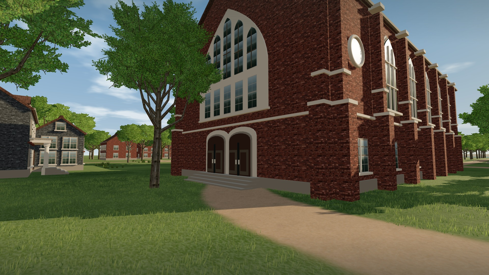
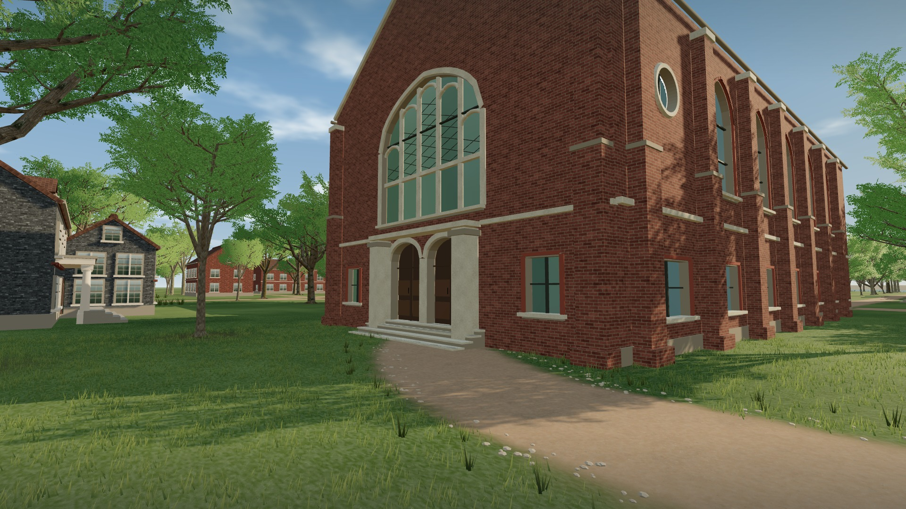
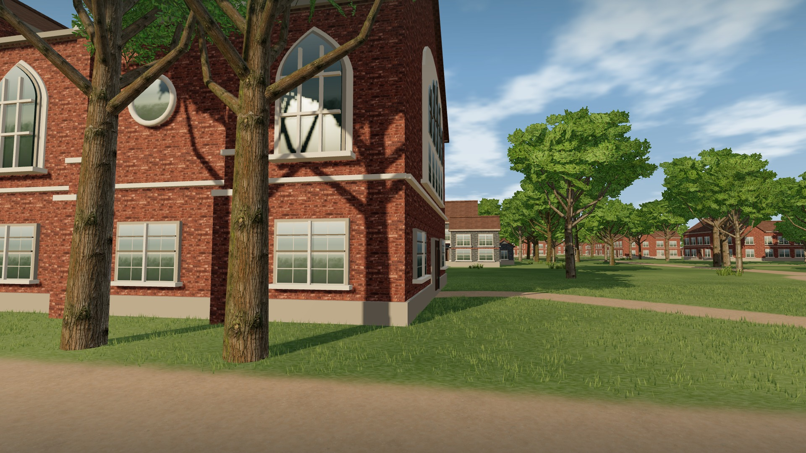
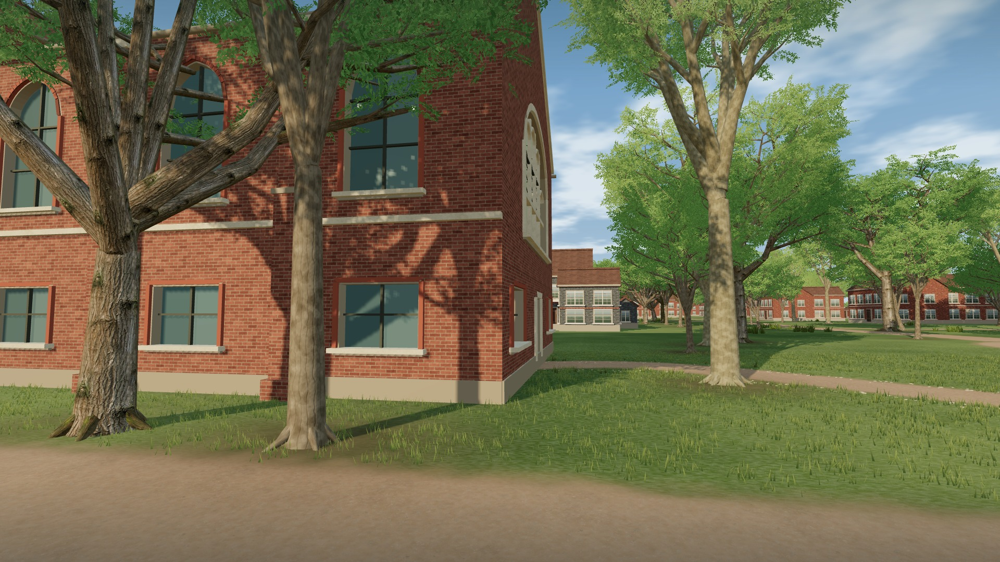
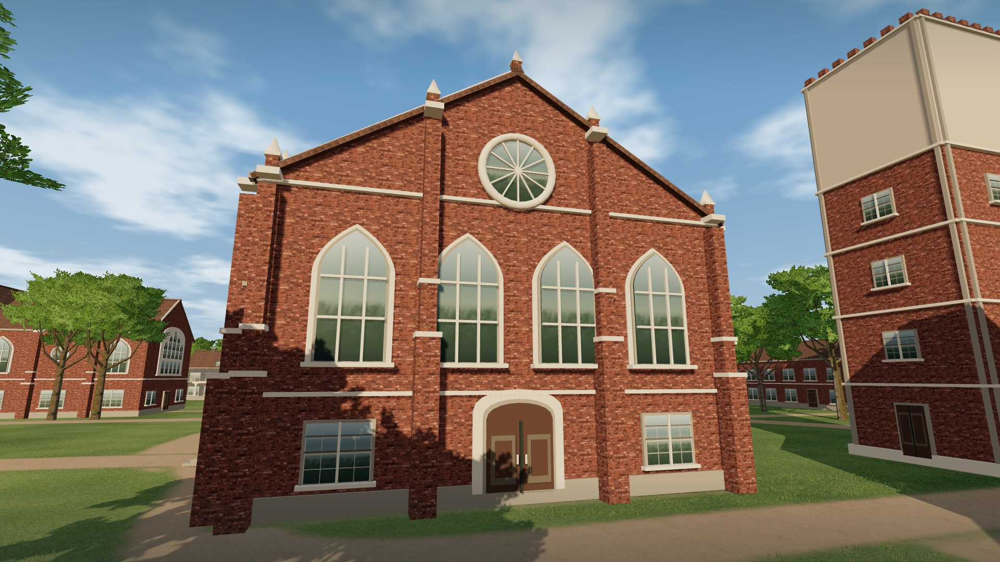
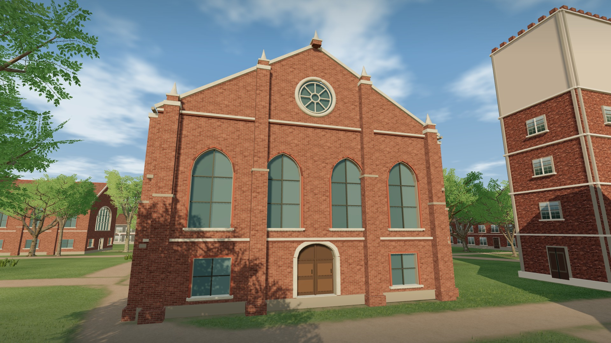
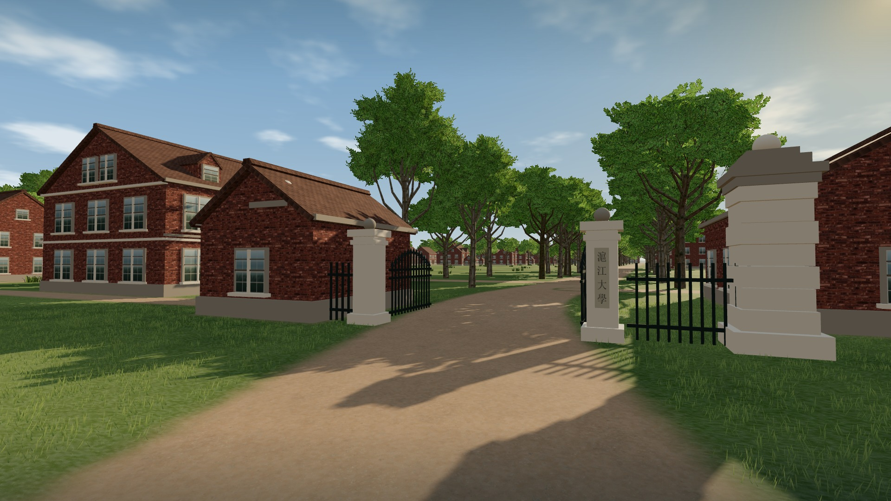
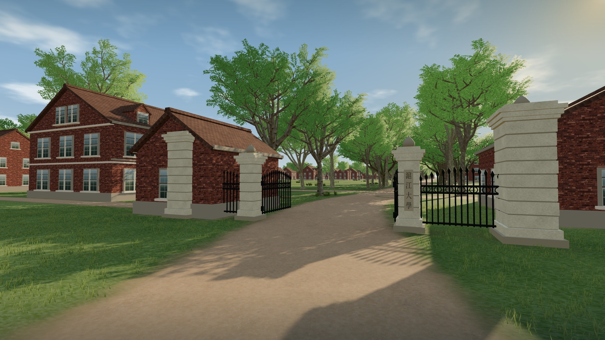
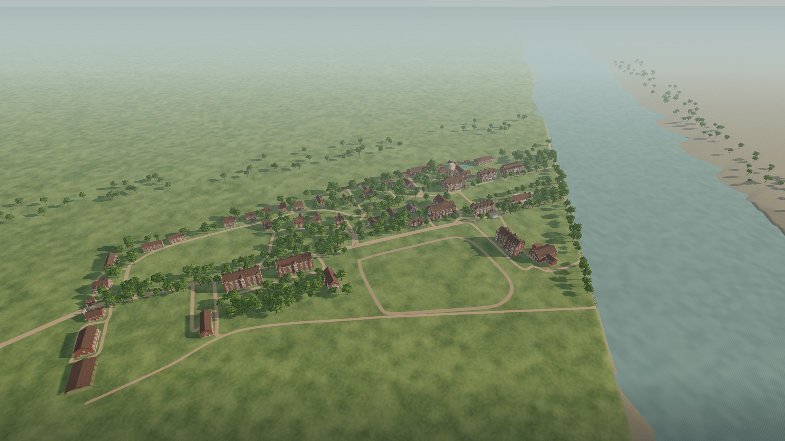
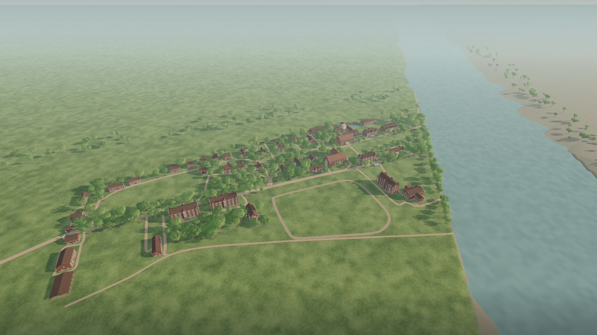

# 1937 年校园美术升级 · 同机位对照

五组图均来自断网打开的单文件漫游。升级前使用 `master` 的 `1ca43e1`，升级后使用随此目录提交的版本。两版使用同一台电脑、同一套相机坐标和视角、同一高画质档位。Edge 以 1920 × 1080 原生绘制，画幅内隐藏了导览界面。

[五组拼图](同机位对比.jpg) · [九株基础树形与叶形](九株树形.jpg) · [模型来源、尺寸与推定范围](../../art/README.md)

另有一组针对树形跳变和窗台漏景的复核。上两排在礼堂北侧，沿同一条直线将相机与榉树树干的水平距离从 43.8 米缩至 40 米。下排俯视西侧低窗的玻璃与窗台。左右两列分别取自美术分支初版 `43e2f7f` 与修复版，同一排采用相同机位和裁切。[树形与窗台修复对照](树形与窗台复核.jpg)

| 机位与观察点 | 升级前 | 升级后 |
| --- | --- | --- |
| 大礼堂暨思魏堂西入口。看双联门洞的进深、山墙花窗、扶壁和路肩。 | [](升级前/auditorium.jpg) | [](升级后/auditorium.jpg) |
| 礼堂北侧林间。看近处树根与主干的分叉，以及路对面的树冠。 | [](升级前/grove.jpg) | [](升级后/grove.jpg) |
| 思晏堂东山墙。看玫瑰窗的石棂、拱券厚度和屋顶尖饰。 | [](升级前/yates.jpg) | [](升级后/yates.jpg) |
| 密氏校门。看石柱座、压顶、题字、开启的铁门和地面投影。 | [](升级前/gate.jpg) | [](升级后/gate.jpg) |
| 校园鸟瞰。以运动场、道路、江岸作定位，比较林带的疏密和不同方向的树冠。 | [](升级前/aerial.jpg) | [](升级后/aerial.jpg) |

## 在漫游里复核

1. 从校园导览选择「大礼堂暨思魏堂」，点「到建筑旁步行」。沿路走到西门，可以逐级上台阶，停在关闭的门扇前。走到北侧可近看林下枝干和北翼侧窗。
2. 点选思晏堂东山墙的玫瑰窗或密氏校门的石柱，可以打开对应史料卡，再用卡片上的按钮定位到建筑旁。打开全校地图、切换鸟瞰或从人物位置起飞，仍可辨认同一处建筑。
3. 开发入口和离线单文件均有自动化用例，覆盖九个树形、三处建筑拾取、落位和台阶。全套命令见[开发与验证](../../README.md#开发与验证)。六个 GLB 已通过 Khronos glTF Validator，零错误、零警告。
4. 树形回归用例在三档画质下核对同一株的枝干、叶簇和实例变形，并用键盘跨过原来的切换距离再退回。窗洞用例从多个方向检查玻璃与石窗台、窗侧、拱顶和圆窗的接缝，还检查礼堂和思魏堂各自的地板及两翼之间的露天院落。[专项回归](../../tests/scene-continuity.cjs)

## 重拍

将两个版本的 `hujiang.html` 放在不同目录，从项目根目录运行以下命令。截图脚本使用仓库测试所用的 Playwright。相机坐标、观察点和视口都保存在脚本里。[固定机位](../../tools/art-review.cjs)

```sh
node tools/art-review.cjs path/to/baseline/hujiang.html review/before
node tools/art-review.cjs hujiang.html review/after
```
